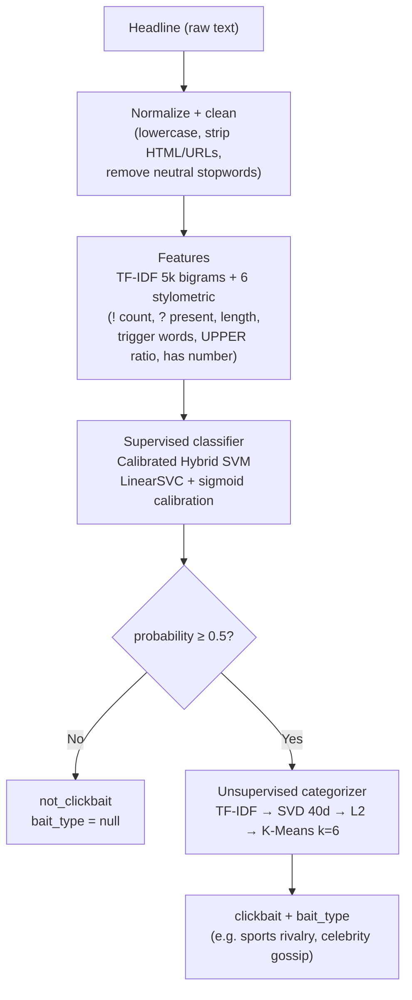
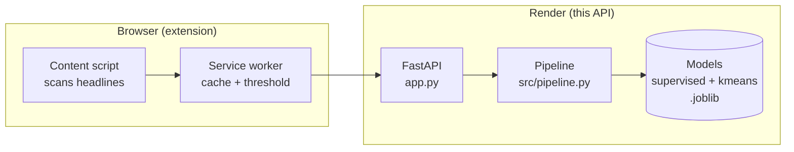

# QuestionAI API

*Languages: [Português](README.md) · **English***

<p align="center">
  
</p>

Clickbait detection API (FastAPI). Receives Portuguese headlines and returns whether each is clickbait, with probability and the attention-grabbing tactic. Production runs **K-Means only**.

---

## Quick start

```bash
pip install -r requirements.txt
python app.py          # PORT=8000 (env: PORT, WORKERS)
```

Smoke test:

```bash
curl -X POST localhost:8000/api/predict \
  -H 'Content-Type: application/json' \
  -d '{"headline": "Você não vai acreditar no que aconteceu!"}'
```

Expected response:

```json
{
  "headline": "Você não vai acreditar no que aconteceu!",
  "is_clickbait": true,
  "clickbait_status": "clickbait",
  "probability": 0.9997,
  "confidence": 0.9994,
  "bait_type": "Incredulidade"
}
```

---

## How it works

Two independent ML stages in sequence:



- Empty/whitespace input → `not_clickbait` with `probability=0.0` (never reaches models).
- Results memoized in per-process LRU cache (2048 entries, thread-safe).

### In the system



---

## Endpoints

| Method & path | Input | Output |
|---------------|-------|--------|
| `GET /health`, `GET /api/health` | — | `status`, `supervised_loaded`, `unsupervised_loaded`, `hdbscan_loaded` (503 if models missing) |
| `POST /predict` | `?headline=...&model=kmeans` or JSON `PredictRequest` (single or batch) | single or `{results, total}` |
| `POST /predict_batch` | `{headlines: [...], model}` | `{results, total}` |
| `POST /api/predict` | `{headline}` or `{headlines}` (`data` accepted as legacy alias) | single or `{results, total}` |

- `model`: `"kmeans"` (default) or `"hdbscan"`; anything else = 422.
- Batch cap: **100 headlines max** (413 over).
- Rate limit: **60 req/min/IP** (in-memory, no deps). Localhost/tests bypass.
- Honest health: `/health` = 503 without supervised model.

### Response schema

| Field | Meaning |
|-------|---------|
| `headline` | Echo of input |
| `is_clickbait` | `probability ≥ 0.5` |
| `clickbait_status` | `"clickbait"` or `"not_clickbait"` |
| `probability` | Calibrated P(clickbait), 0–1 |
| `confidence` | `\|prob − 0.5\| × 2`, 0–1 |
| `bait_type` | Tactic name, or `null` (not clickbait or no categorizer) |

---

## Project structure

```text
app.py                 # Routes, validation, rate limit, health (entry point)
src/
  pipeline.py          # SupervisedPredictor, K-Means/HDBSCAN, orchestration + cache
  features.py          # normalize_text, clean_text, 6 features, stopwords
models/
  supervised_model.joblib      # Calibrated Hybrid SVM (~460 KB)
  unsupervised_model.joblib    # Spherical K-Means (~1.2 MB)
  cluster_topics.json          # cluster id → tactic name
  metadata.json                # Training metrics and config
data/                          # (gitignored) detector-clickbait-br-processed.csv ~9.5k rows
scripts/
  train.py             # Retrain supervised + K-Means from data/
  train_hdbscan.py     # Train HDBSCAN (local only)
  verify_models.py     # Validate saved artifacts
  stress_test_m2.py    # Manual endpoint/load stress
tests/                 # (local, gitignored) 312 pytest tests
assets/                # logo.svg, simbolo.svg
```

---

## Retrain

```bash
python scripts/train.py              # supervised + K-Means → models/
python scripts/verify_models.py      # check artifacts
```

---

## HDBSCAN (local only)

HDBSCAN categorizer (embeddings + UMAP + HDBSCAN, ~441 MB) **not deployed** — deps in `requirements-hdbscan.txt`, production serves K-Means.

```bash
pip install -r requirements-hdbscan.txt
python scripts/train_hdbscan.py      # → models/unsupervised_hdbscan.joblib
```

Or download from [modelos-hdbscan-v1 release](https://github.com/gu-css/QuestionAI-api/releases/tag/modelos-hdbscan-v1) into `models/`. When present, use `model=hdbscan`; noise (`-1`) → `bait_type: null`.

---

## Model card

From `models/metadata.json`: Calibrated Hybrid SVM (Approach C), 8,456 train / 934 test — accuracy 0.9893, precision/recall/F1 0.9901, ROC AUC 0.9995, threshold 0.5. K-Means: TF-IDF → SVD 40d → L2 → 6 clusters.

---

## Deploy (Render)

`render.yaml`: `pip install -r requirements.txt`, `python app.py`, Python 3.10.12. Single service `clickbait-api`.

---

## Tests (local)

```bash
python -m pytest tests/ -q
```

> Test suite (312 tests) stays out of git. Covers endpoints, adversarial (XSS/SQLi/emoji/null bytes/giant payloads), concurrency (30 threads), degraded states, and JS harnesses for the extension.