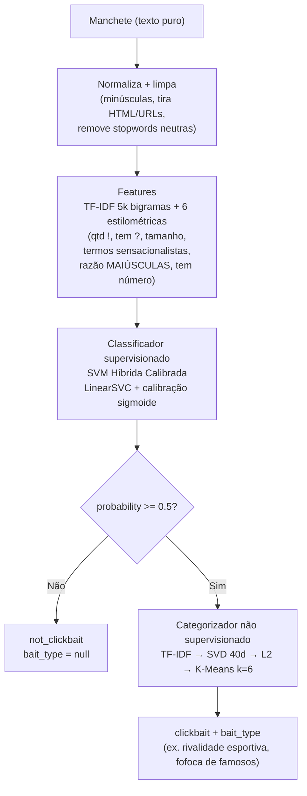
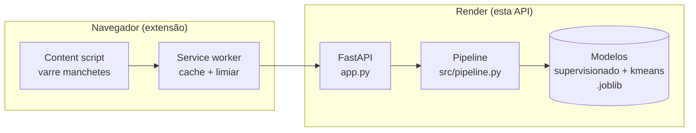

# QuestionAI API

*Idiomas: **Português** · [English](README-en.md)*

<p align="center">
  
</p>

API de detecção de clickbait (FastAPI). Recebe manchetes de notícias em
português e responde se cada uma é clickbait, com probabilidade e a tática
de atenção usada. Produção roda só K-Means.

## O que faz

Envie uma manchete, receba o veredito:

```json
POST /api/predict  { "headline": "Você não vai acreditar no que aconteceu com esse famoso!" }
```

```json
{
  "headline": "Você não vai acreditar no que aconteceu com esse famoso!",
  "is_clickbait": true,
  "clickbait_status": "clickbait",
  "probability": 0.9997,
  "confidence": 0.9994,
  "bait_type": "Incredulidade"
}
```

## Como funciona

Dois estágios de ML independentes rodam em sequência. O classificador
decide *clickbait ou não*; só o que for clickbait passa ao categorizador,
que nomeia a tática (*bait type*).



Entrada vazia ou só espaços retorna `not_clickbait` com probabilidade
`0.0` direto — nem chega aos modelos. Resultados ficam num cache LRU
por processo (2048 entradas, thread-safe).

### Onde ela fica no sistema



## Endpoints

| Método e rota | Corpo / params | Resposta |
|---------------|----------------|----------|
| `GET /health`, `GET /api/health` | — | `status`, `supervised_loaded`, `unsupervised_loaded`, `hdbscan_loaded` (503 sem modelos) |
| `POST /predict` | `?headline=...&model=kmeans`, ou JSON `PredictRequest` (único ou lote) | resultado único, ou `{results, total}` em lote |
| `POST /predict_batch` | `{headlines: [...], model}` | `{results, total}` |
| `POST /api/predict` | `{headline}` ou `{headlines}` (`data` aceito como alias legado) | resultado único, ou `{results, total}` |

`model` é `"kmeans"` (padrão) ou `"hdbscan"`; qualquer outro valor dá 422.
Respostas em lote sempre trazem `total`.

### Schema de resposta

| Campo | Significado |
|-------|-------------|
| `headline` | Eco da entrada |
| `is_clickbait` | `probability >= 0.5` |
| `clickbait_status` | `"clickbait"` ou `"not_clickbait"` |
| `probability` | P(clickbait) calibrada, 0–1 |
| `confidence` | `\|prob − 0.5\| × 2`, 0–1 |
| `bait_type` | Nome da tática, ou `null` quando não é clickbait (ou sem categorizador) |

### Proteções embutidas

- **Limite de lote:** máx. 100 manchetes por request (413 acima) — um request gigante não derruba a hospedagem pequena.
- **Rate limit:** 60 requests/min por IP, em memória, sem dependência. Localhost e testes passam direto.
- **Health honesto:** `/health` retorna 503 sem o modelo supervisionado — deploy quebrado nunca parece saudável.

## Estrutura do projeto

```text
app.py                 # Rotas, validação, rate limit, health (entry point)
src/
  pipeline.py          # SupervisedPredictor, categorizadores K-Means/HDBSCAN, orquestração + cache
  features.py          # normalize_text, clean_text, 6 features estilométricas, stopwords
models/
  supervised_model.joblib      # SVM Híbrida Calibrada (~460 KB)
  unsupervised_model.joblib    # K-Means esférico (~1.2 MB)
  cluster_topics.json          # cluster id → nome da tática
  metadata.json                # Métricas de treino e config
data/
  detector-clickbait-br-processed.csv  # Dados de treino (~9.5k linhas)
scripts/
  train.py             # Retreina supervisionado + K-Means a partir de data/
  train_hdbscan.py     # Treina o categorizador HDBSCAN (só local)
  verify_models.py     # Checa os artefatos salvos
  stress_test_m2.py    # Stress manual de endpoints/carga
  build_docs.py / generate_icons.py / heavy_stress_test.py  # Utilitários pontuais
tests/                 # Suíte pytest (312 testes): API, modelos, adversarial, harnesses da extensão
assets/                # Marca: logo.svg (lockup completo), simbolo.svg (Q)
```

## Rodar local

```sh
pip install -r requirements.txt
python app.py  # PORT=8000, WORKERS=1 (via env)
```

Teste rápido:

```sh
curl -X POST localhost:8000/api/predict \
  -H 'Content-Type: application/json' \
  -d '{"headline": "Você não vai acreditar no que aconteceu!"}'
```

## Testes

```sh
python -m pytest tests/ -q
```

(A suíte de testes é local e fica fora do git.)
312 testes: endpoints, qualidade do modelo, entradas adversariais
(XSS/SQLi/emoji/null bytes/payloads gigantes), concorrência (30 threads),
estados degradados (sem modelo não supervisionado) e harnesses JS da
extensão (falhas de rede do service worker, casos DOM do content script).

## Retreinar

```sh
python scripts/train.py              # supervisionado + K-Means → models/
python scripts/verify_models.py      # checa os artefatos
```

## HDBSCAN (só local)

O categorizador HDBSCAN (embeddings semânticos + UMAP + HDBSCAN, ~441 MB)
é gitignored e nunca vai ao deploy: as deps estão em
`requirements-hdbscan.txt` e a produção serve K-Means.

```sh
pip install -r requirements-hdbscan.txt
python scripts/train_hdbscan.py      # → models/unsupervised_hdbscan.joblib
```

Ou baixe da
[release modelos-hdbscan-v1](https://github.com/gu-css/QuestionAI-api/releases/tag/modelos-hdbscan-v1)
para dentro de `models/`. Quando presente, clientes pedem com
`model=hdbscan`; pontos de ruído (`-1`) viram `bait_type: null`.

## Model card

De `models/metadata.json`: SVM Híbrida Calibrada (Approach C), treinada
em 8.456 manchetes, testada em 934 — acurácia 0.9893,
precisão/recall/F1 0.9901, ROC AUC 0.9995, limiar 0.5.
Categorizador K-Means: TF-IDF → SVD 40 dims → L2 → 6 clusters.

## Deploy (Render)

Blueprint em `render.yaml`: `pip install -r requirements.txt`,
sobe com `python app.py`, Python 3.10.12. Serviço web único
`clickbait-api`.
