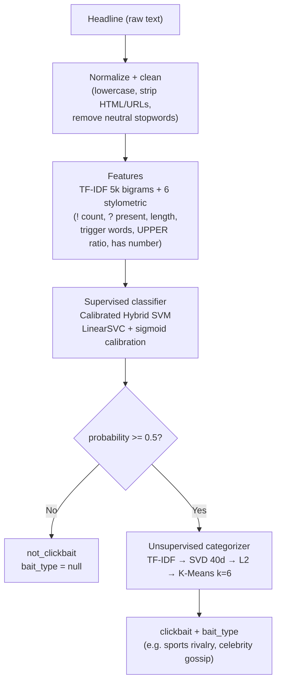
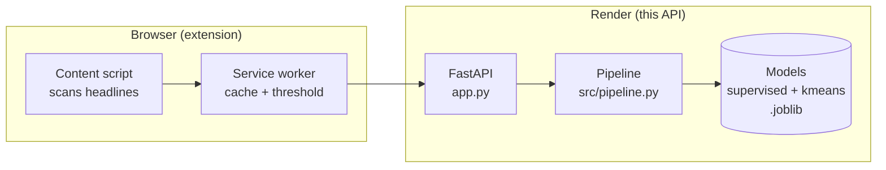

# QuestionAI API

<p align="center">
  
</p>

Clickbait detection API (FastAPI). Receives Portuguese news headlines and
returns whether each one is clickbait, with a probability and the
attention-grabbing tactic it uses. Production runs K-Means only.

## What it does

Send a headline, get back a verdict:

```json
POST /api/predict  { "headline": "Você não vai acreditar no que aconteceu com esse famoso!" }
```

```json
{
  "headline": "Você não vai acreditar no que aconteceu com esse famoso!",
  "is_clickbait": true,
  "clickbait_status": "clickbait",
  "probability": 0.9997,
  "confidence": 0.9994,
  "bait_type": "Incredulidade"
}
```

## How it works

Two independent ML stages run in sequence. The classifier decides
*clickbait or not*; only clickbait goes to the categorizer, which names
the tactic (*bait type*).



Empty or whitespace-only input short-circuits to `not_clickbait` with
probability `0.0` — it never reaches the models. Results are memoized in
a per-process thread-safe LRU cache (2048 entries).

### Where it sits in the system



## Endpoints

| Method & path      | Body / params | Response |
|--------------------|---------------|----------|
| `GET /health`, `GET /api/health` | — | `status`, `supervised_loaded`, `unsupervised_loaded`, `hdbscan_loaded` (503 when models missing) |
| `POST /predict`    | `?headline=...&model=kmeans`, or JSON `PredictRequest` (single or batch) | single result, or `{results, total}` for batch |
| `POST /predict_batch` | `{headlines: [...], model}` | `{results, total}` |
| `POST /api/predict` | `{headline}` or `{headlines}` (`data` accepted as legacy alias) | single result, or `{results, total}` |

`model` is `"kmeans"` (default) or `"hdbscan"`; anything else is 422.
Batch responses always carry `total`.

### Response schema

| Field | Meaning |
|-------|---------|
| `headline` | Echo of the input |
| `is_clickbait` | `probability >= 0.5` |
| `clickbait_status` | `"clickbait"` or `"not_clickbait"` |
| `probability` | Calibrated P(clickbait), 0–1 |
| `confidence` | `\|prob − 0.5\| × 2`, 0–1 |
| `bait_type` | Tactic name, or `null` when not clickbait (or categorizer unavailable) |

### Built-in guards

- **Batch cap:** max 100 headlines per request (413 over) — one giant request can't OOM the small hosting box.
- **Rate limit:** 60 requests/min per IP, in-memory, no dependency. Localhost and test clients bypass it.
- **Honest health:** `/health` returns 503 when the supervised model isn't loaded, so a broken deploy never looks healthy.

## Project structure

```text
app.py                 # Routes, validation, rate limit, health (entry point)
src/
  pipeline.py          # SupervisedPredictor, K-Means/HDBSCAN categorizers, orchestration + cache
  features.py          # normalize_text, clean_text, 6 stylometric features, stopword lists
models/
  supervised_model.joblib      # Calibrated Hybrid SVM (~460 KB)
  unsupervised_model.joblib    # Spherical K-Means (~1.2 MB)
  cluster_topics.json          # Cluster id → tactic name
  metadata.json                # Training metrics and config
data/
  detector-clickbait-br-processed.csv  # Training data (~9.5k rows)
scripts/
  train.py             # Retrain supervised + K-Means from data/
  train_hdbscan.py     # Train the HDBSCAN categorizer (local only)
  verify_models.py     # Sanity-check saved artifacts
  stress_test_m2.py    # Manual load/endpoint stress script
  build_docs.py / generate_icons.py / heavy_stress_test.py  # One-off utilities
tests/                 # pytest suite (312 tests): API, models, adversarial, extension harnesses
assets/                # Brand: logo.svg (full lockup), simbolo.svg (Q mark)
```

## Run locally

```sh
pip install -r requirements.txt
python app.py  # PORT=8000, WORKERS=1 (env-overridable)
```

Smoke test:

```sh
curl -X POST localhost:8000/api/predict \
  -H 'Content-Type: application/json' \
  -d '{"headline": "Você não vai acreditar no que aconteceu!"}'
```

## Tests

```sh
python -m pytest tests/ -q
```

312 tests covering endpoints, model quality, adversarial inputs
(XSS/SQLi/emoji/null bytes/huge payloads), concurrency (30 threads),
degraded states (missing unsupervised model), and the browser-extension
JS harnesses (service-worker network failures, content-script DOM cases).

## Retraining

```sh
python scripts/train.py              # supervised + K-Means → models/
python scripts/verify_models.py      # check the artifacts
```

## HDBSCAN (local only)

The HDBSCAN categorizer (semantic embeddings + UMAP + HDBSCAN, ~441 MB)
is gitignored and never deployed: its deps live in
`requirements-hdbscan.txt` and production serves K-Means.

```sh
pip install -r requirements-hdbscan.txt
python scripts/train_hdbscan.py      # → models/unsupervised_hdbscan.joblib
```

Or download it from the
[modelos-hdbscan-v1 release](https://github.com/gu-css/QuestionAI-api/releases/tag/modelos-hdbscan-v1)
into `models/`. When present, clients can request it with `model=hdbscan`;
noise points (`-1`) map to `bait_type: null`.

## Model card

From `models/metadata.json`: Calibrated Hybrid SVM (Approach C),
trained on 8,456 headlines, tested on 934 — accuracy 0.9893,
precision/recall/F1 0.9901, ROC AUC 0.9995, decision threshold 0.5.
K-Means categorizer: TF-IDF → SVD 40 dims → L2 → 6 clusters.

## Deploy (Render)

Blueprint in `render.yaml`: `pip install -r requirements.txt`,
start with `python app.py`, Python 3.10.12. Single web service
`clickbait-api`.
