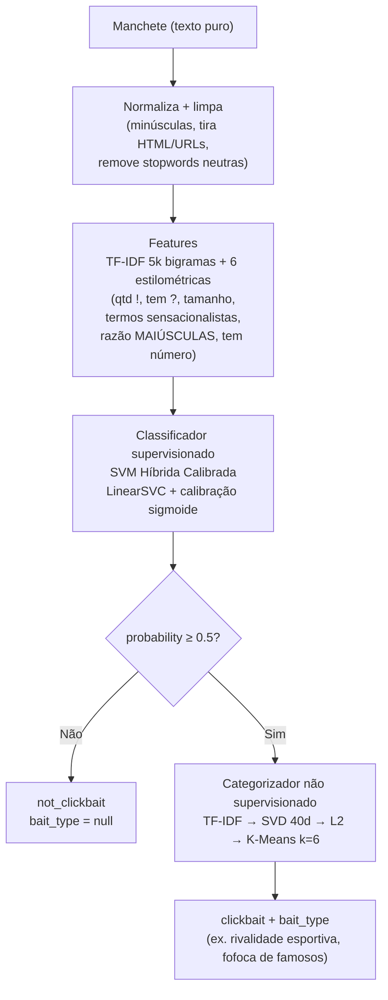
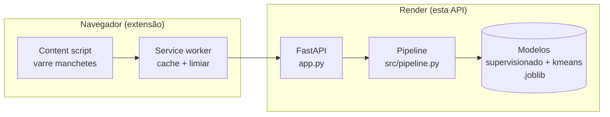

# QuestionAI API

*Idiomas: **Português** · [English](README-en.md)*

<p align="center">
  
</p>

API de detecção de clickbait (FastAPI). Recebe manchetes em português e retorna se cada uma é clickbait, com probabilidade e a tática de atenção usada. Produção roda **apenas K-Means**.

---

## Quick start

```bash
pip install -r requirements.txt
python app.py          # PORT=8000 (env: PORT, WORKERS)
```

Teste rápido:

```bash
curl -X POST localhost:8000/api/predict \
  -H 'Content-Type: application/json' \
  -d '{"headline": "Você não vai acreditar no que aconteceu!"}'
```

Resposta esperada:

```json
{
  "headline": "Você não vai acreditar no que aconteceu!",
  "is_clickbait": true,
  "clickbait_status": "clickbait",
  "probability": 0.9997,
  "confidence": 0.9994,
  "bait_type": "Incredulidade"
}
```

---

## Como funciona

Dois estágios ML independentes em sequência:



- Entrada vazia/somente espaços → `not_clickbait` com `probability=0.0` (não chega nos modelos).
- Resultados cacheados em LRU por processo (2048 entradas, thread-safe).

### No sistema



---

## Endpoints

| Método e rota | Entrada | Saída |
|---------------|---------|-------|
| `GET /health`, `GET /api/health` | — | `status`, `supervised_loaded`, `unsupervised_loaded`, `hdbscan_loaded` (503 sem modelos) |
| `POST /predict` | `?headline=...&model=kmeans` ou JSON `PredictRequest` (único ou lote) | único ou `{results, total}` |
| `POST /predict_batch` | `{headlines: [...], model}` | `{results, total}` |
| `POST /api/predict` | `{headline}` ou `{headlines}` (`data` aceito como alias legado) | único ou `{results, total}` |

- `model`: `"kmeans"` (padrão) ou `"hdbscan"`; outro valor = 422.
- Lotes: máx. **100 manchetes** (413 acima).
- Rate limit: **60 req/min/IP** (memória, sem dep.). Localhost/testes passam direto.
- Health honesto: `/health` = 503 sem modelo supervisionado.

### Schema de resposta

| Campo | Significado |
|-------|-------------|
| `headline` | Eco da entrada |
| `is_clickbait` | `probability ≥ 0.5` |
| `clickbait_status` | `"clickbait"` ou `"not_clickbait"` |
| `probability` | P(clickbait) calibrada, 0–1 |
| `confidence` | `\|prob − 0.5\| × 2`, 0–1 |
| `bait_type` | Nome da tática, ou `null` (não clickbait ou sem categorizador) |

---

## Estrutura

```text
app.py                 # Rotas, validação, rate limit, health (entry point)
src/
  pipeline.py          # SupervisedPredictor, K-Means/HDBSCAN, orquestração + cache
  features.py          # normalize_text, clean_text, 6 features, stopwords
models/
  supervised_model.joblib      # SVM Híbrida Calibrada (~460 KB)
  unsupervised_model.joblib    # K-Means esférico (~1.2 MB)
  cluster_topics.json          # cluster id → nome da tática
  metadata.json                # Métricas de treino e config
data/                          # (gitignored) detector-clickbait-br-processed.csv ~9.5k linhas
scripts/
  train.py             # Retreina supervisionado + K-Means a partir de data/
  train_hdbscan.py     # Treina HDBSCAN (só local)
  verify_models.py     # Checa artefatos salvos
  stress_test_m2.py    # Stress manual de endpoints/carga
tests/                 # (local, gitignored) 312 testes pytest
assets/                # logo.svg, simbolo.svg
```

---

## Retreinar

```bash
python scripts/train.py              # supervisionado + K-Means → models/
python scripts/verify_models.py      # valida artefatos
```

---

## HDBSCAN (só local)

O categorizador HDBSCAN (embeddings + UMAP + HDBSCAN, ~441 MB) **não vai ao deploy** — deps em `requirements-hdbscan.txt`, produção usa K-Means.

```bash
pip install -r requirements-hdbscan.txt
python scripts/train_hdbscan.py      # → models/unsupervised_hdbscan.joblib
```

Ou baixe da [release modelos-hdbscan-v1](https://github.com/gu-css/QuestionAI-api/releases/tag/modelos-hdbscan-v1) para `models/`. Quando presente, use `model=hdbscan`; ruído (`-1`) → `bait_type: null`.

---

## Model card

De `models/metadata.json`: SVM Híbrida Calibrada (Approach C), 8.456 treino / 934 teste — acurácia 0.9893, precisão/recall/F1 0.9901, ROC AUC 0.9995, limiar 0.5. K-Means: TF-IDF → SVD 40d → L2 → 6 clusters.

---

## Deploy (Render)

`render.yaml`: `pip install -r requirements.txt`, `python app.py`, Python 3.10.12. Serviço `clickbait-api`.

---

## Testes (local)

```bash
python -m pytest tests/ -q
```

> A suíte (312 testes) fica fora do git. Cobre endpoints, adversarial (XSS/SQLi/emoji/null bytes/giant payloads), concorrência (30 threads), estados degradados e harnesses JS da extensão.